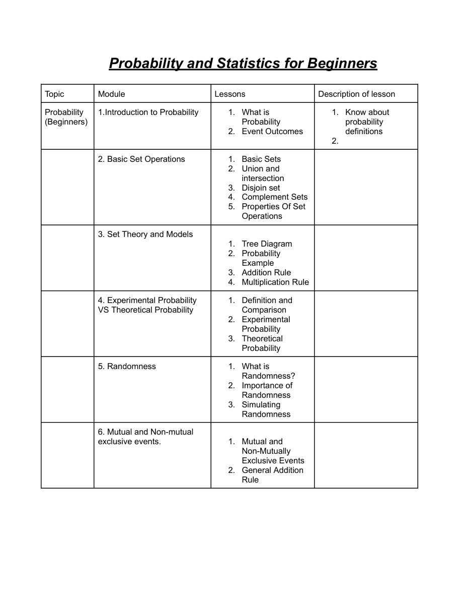
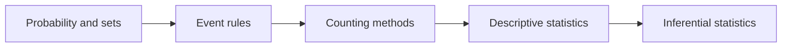

# Probability and statistics curriculum draft

A lesson-planning artifact prepared during the Kidocode internship for beginner and intermediate probability/statistics teaching. The repository contains a topic-outline PDF and an editable planning workbook. It demonstrates curriculum organization; no delivered-course outcomes, learner testing or software application are claimed.

**Current status:** draft. The workbook contains **five modules and 25 lesson entries**. Task, task-type and description fields are unpopulated. Counting methods appear in the workbook's beginner sequence while the PDF places them in the intermediate sequence; reconcile this before teaching from it.



*Rendered original PDF page 1, inspected on 17 October 2026. This previews the existing draft rather than a redesigned or completed course.*

## Contents and use

| Artifact | Purpose |
|---|---|
| [Course outline PDF](probability%20%26%20statistics%20Course%20Outline.docx.pdf) | Three-page overview of probability, event rules, descriptive/inferential statistics and counting methods |
| [Editable workbook](Probability%20and%20Statistics%20Course%20Outline.xlsx) | Lesson planning with module, lesson, task, task type and description columns |



*This follows the workbook sequence; the PDF organizes the levels differently.*

Open the PDF in a viewer and the workbook in Excel or LibreOffice. The next planning step is to settle prerequisites and level placement, then define lesson activities and assessment criteria. These are outstanding content decisions, not completed features.

## Verification

No application runtime applies. A Python standard-library check inspects workbook ZIP/XML without changing it:

```powershell
python docs/verify_outline.py
```

It verifies archive integrity, five module labels, 25 lesson entries, empty task fields and the absence of formulas. [outline-check.json](docs/outline-check.json) records the exact cell references and content. The [verification record](docs/VERIFICATION.md) describes PDF inspection and remaining limitations.

The original short README is preserved in [PROJECT_GUIDE.md](docs/PROJECT_GUIDE.md). Internship context is retained from the existing documentation; no additional authorship, adoption or learning-impact claim is inferred. No repository license file is present, and teaching reuse should respect the material's ownership.
